# Véglegesített megvalósítási terv — `TODO.md`

Ez a dokumentum a `TODO.md` összes elemét tartalmazza a véglegesített döntésekkel és önállóan tesztelhető részfeladatokra bontva, hogy külön szálakon, egyesével is megvalósítható és ellenőrizhető legyen.

---

## Rögzített tervezési döntések

1. **Sorkapocs csavarok:** A felhasználónak nem kell előre kicsavarnia a csavarokat — az üres sorkapcsok alapból **kilazított (`tight: false`)** állapotból indulnak, a csavarok kattintási zónája pontos (átfedés nélküli), és a felső/alsó csavarok horonyiránya egységes.
2. **3 fázisú villanymotor csatlakozása:** Kapocsléc helyett a sorkapocs-kiosztási poszter alatt **6+1 db rögzített 3-as WAGO** található, amelyek 1. nyílásába gyárilag/fixen be vannak kötve a motor kábeléből érkező **fekete** (`U1`, `V1`, `W1`, `U2`, `V2`, `W2` — fehér szigszalag zászlócskákkal jelölve) és **zöld-sárga** (`PE`) erek.
3. **Kábelszín-validáció:** Kizárólag a 3 alapszabályt ellenőrzi: **Fekete** = fázisvezető (minden fázis- és kapcsolt fáziság, `L1/L2/L3` további bontás nélkül), **Kék** = nullavezető (`N`), **Zöld-sárga** = védővezető (`PE`).
4. **Kezdőállapot és ÁVK-k:** Mindig **minden `KI` állapotban indul** (kismegszakítók, mindkét ÁVK, motorvédő, kapcsolók). Az ÁVK-knak **nincs** külön sorkapocs-kivezetésük; belsőleg csak az őket követő kismegszakítókat (és a hozzájuk tartozó nulla kört) védik.
5. **Eszközök, tekercsek, szerszámok:** **Hibrid megoldás** — az alsó Canvas munkapad elemei (vezetéktekercsek, WAGO dobozok, szerszámok, műszerek) közvetlenül kattinthatók, és emellett a felső sávban is szöveg nélküli grafikus SVG ikonok állnak rendelkezésre rázoomolt munkához.

---

## I. Lefejlesztendő elemek

### 1. 3 fázisú villanymotor

A falon már meglévő `3P C16A`, `Motorvédő`, `Időrelé` és `MK1–MK3` mágneskapcsolók segítségével direkt indítás, forgásirány-váltás és csillag–delta (Y/Δ) indítás is megvalósítható.

- **Elhelyezés a Canvas-on:**
  - A **sorkapocs poszter** (`y = 725..1040`) magassága kissé tömörül (pl. `y = 700..945`), így közvetlenül a poszter alatt (`y = 955..1060`) tiszta hely nyílik a motor **6+1 db fix 3-as WAGO**-jának és a kábelbevezetésnek.
  - Maga a **3 fázisú villanymotor** a fal jobb oldalán (az alsó sorkapocssor mellett, `x = 1900..2175, y = 375..695`) jelenik meg, ahonnan vastag fekete motorkábel fut le a poszter alatti 6+1 db 3-as WAGO-hoz.
- **6+1 db rögzített 3-as WAGO (valós gyakorlati bekötés):**
  - **6 db tekercs-kivezetés (`U1`, `V1`, `W1`, `U2`, `V2`, `W2`):**
    - Mindegyik 3-as WAGO 1. portjában gyárilag, fixen (zárt karral, nem bonthatóan) egy **fekete** vezeték van bekötve a motor kábelkötegéből.
    - Minden fekete éren a WAGO felett egy **fehér szigetelőszalag fül (zászlócska)** látható a ráírt kivezetés kóddal: `U1`, `V1`, `W1`, `U2`, `V2`, `W2`.
    - A maradék 2-2 szabad WAGO nyílás nyitott karral indul: a tanuló ide kötheti a csillag/delta áthidalókat és a betáp/mágneskapcsoló szálakat.
  - **+1 db védővezető (`PE`) 3-as WAGO:**
    - Az 1. portjában fixen a kábelkötegből érkező **zöld-sárga (`PE`)** vezeték van bekötve (opcionálisan `PE` jelölőfüllel), 2 szabad nyílással.
  - **Védelem:** A motor WAGO-i `fixed: true` jelölést kapnak: nem mozgathatók, nem dobhatók vissza a WAGO dobozba, és a gyári 1. karjuk nem nyitható ki (próbálkozáskor tájékoztató toast).
- **Szimuláció (`src/engine/simulation.ts`):**
  - 3 tekercs (`U1–U2`, `V1–V2`, `W1–W2`) kiértékelése a potenciálok és az összekötött gráf alapján:
    - **Csillagüzem (Y):** `U2`, `V2`, `W2` azonos összefüggő komponensben van (pl. áthidalt WAGO-k vagy behúzott `MK2`), és `U1, V1, W1` három különböző fázist kap (`L1, L2, L3`).
    - **Deltaüzem (Δ):** mindhárom tekercsen 400V fázis–fázis feszültség van szabályos háromszög-kapcsolásban (pl. `U1–W2`, `V1–U2`, `W1–V2` áthidalva vagy `MK1` + `MK3`-on át).
    - **Forgásirány:** `L1–L2–L3` ciklikus sorrend → jobbra (`CW`), két fázis felcserélve → balra (`CCW`).
    - **Hibaállapotok:** 2 fázisú táplálásnál nem forog szabályosan (búg/rezeg, megnövekedett áram, figyelmeztetés); hibás Y+Δ egyidejű összekötésnél zárlat (`3P C16A` leold); hiányzó `PE` bekötésnél figyelmeztetés.
  - **Névleges áramok (lakatfogóhoz):** álló `0.0 A`, Csillag `~1.8 A`, Delta vonali `~5.4 A` (tekercság `~3.1 A`), fázishiba `~8.5 A`.
- **Megjelenítés és animáció (`src/canvas/renderer.ts`, `src/main.ts`):**
  - Bordázott ipari motorház, animált forgó tengely/lapát (gyorsulással/lassulással, `CW`/`CCW` nyíllal), üzemmód kijelző (`ÁLL` / `Y ↻` / `Δ ↻` / `↺` / `FÁZISHIBA`).
- **Érintett fájlok:** `src/models/types.ts`, `src/data/prototypeTrack.ts`, `src/models/world.ts`, `src/engine/simulation.ts`, `src/canvas/renderer.ts`, `src/canvas/input.ts`, `src/main.ts`.
- **Tesztelési szempontok:**
  - A poszter alatt megjelenik a 6+1 db fix 3-as WAGO a kábelköteggel és fehér szigszalag fülekkel (`U1..W2` + zöld-sárga `PE`).
  - A fix WAGO-k nem húzhatók el és az 1. karjuk nem nyitható, a 2. és 3. nyílás viszont szabadon beköthető.
  - Csillag kötés (`U2–V2–W2` áthidalva, `U1/V1/W1`-re `L1/L2/L3`) → motor forog jobbra; 2 fázis cseréjével balra forog.
  - 1 fázis lekötésével fázishiba állapot látszik; Delta kötésben is szabályosan forog.

---

### 2. UNI-T folytonosság vizsgáló és feszmérő eszköz

Kétpólusú feszültség- és folytonosságvizsgáló (UNI-T UT18C/UT18D mintára).

- **Új eszközmód:** `ToolMode` bővítése `"tester"` értékkel.
- **Két mérőtüskés működés:**
  - 1. kattintás bármely mérhető pontra (sorkapocs alsó/felső pontja, WAGO nyílás, dugalj, motor WAGO-k) lerakja a **fekete (COM / `-`)** mérőtüskét.
  - Az egér mozgatásával a **piros (`+`)** mérőtüske élőben méri a feszültséget/folytonosságot az aktuális pont és a rögzített fekete tüske között.
  - 2. kattintás rögzíti a piros tüskét is (így Kéz eszközre váltva kapcsolgatás közben is látható a mérés). Jobb klikk / `Esc` / üres helyre kattintás elemeli a tüskéket.
  - A két mérőtüske és mérőzsinór vizuálisan kirajzolódik a Canvas-on.
- **Mérési logika (`src/engine/measurements.ts`):**
  - **Feszültségmérés:**
    - Fázis (`L1/L2/L3`) ↔ `N` vagy `PE` → **`230 V AC`**
    - Két különböző fázis (`L1–L2`, `L2–L3`, `L3–L1`) → **`400 V AC`** + fázissorrend (`R`/`L`)
    - Azonos potenciál vagy lebegő pontok → **`0 V`**
    - Egypólusú fázisjelzés (`⚡` LED), ha valamelyik tüske fázison van.
  - **Folytonosság-vizsgálat (csipogás):**
    - Csak **feszültségmentes** pontok között aktív (ha >12V van, automatikusan feszültséget mér és nem csipog).
    - Gráf-elérhetőség (BFS) meghúzott vezetékeken és zárt érintkezőkön át (kikapcsolt kismegszakítóknál is!).
    - Folytonosságnál `0.0 Ω` / `🔊` LED + **Web Audio API** sípoló hang (némítható); szakadásnál `OL`.
- **Lebegő UNI-T műszerpanel (`src/ui/instrumentPanel.ts`):**
  - LCD kijelző + LED feszültségsáv (`12V / 24V / 50V / 120V / 230V / 400V`) + `AC`, `⚡`, `🔊 Rx`, `R/L` LED-ek + hang némítása / tüskék levétele gomb.
- **Érintett fájlok:** `src/engine/measurements.ts` (új), `src/ui/instrumentPanel.ts` (új), `src/models/types.ts`, `src/canvas/renderer.ts`, `src/canvas/input.ts`, `src/main.ts`, `src/style.css`.
- **Tesztelési szempontok:**
  - Kikapcsolt kismegszakítónál egy meghúzott vezeték két vége vagy egy zárt kapcsoló `1–2` kapcsa között csipog és `0.0 Ω`-t mutat; nyitott kapcsolónál vagy laza csavarnál `OL`.
  - Bekapcsolt ÁVK + kismegszakítónál `L1–N` és `L1–PE` között `230 V AC`, `L1–L2` között `400 V AC` jelenik meg, és feszültség alatt nem csipog folytonosságot.
  - Rögzített tüskékkel Kéz eszközre váltva kapcsoló billentésekor élőben frissül a műszer kijelzője.

---

### 3. ÁVK-k működő tesztgombbal

A `sources/pelda_kotes.jpg` kiosztásának megfelelően **2 db ÁVK** kerül a kiselosztóba, saját sorkapocs-kivezetések nélkül — belsőleg közvetlenül a mögöttük lévő kismegszakítókat (és a hozzájuk tartozó nulla kört) védik:

1. **4P ÁVK (`rcd_3p`, 40A / 30mA):** belsőleg védi a `3P C16A` kismegszakítót és a `3 Fázis Nullája` (`top_3n`) ágat.
2. **2P ÁVK (`rcd_1p`, 25A / 30mA):** belsőleg védi az `1P B10A` és `1P B16A` kismegszakítókat és az `1 Fázis Nullája` (`top_1n`) ágat.

- **Kiselosztó elrendezés (`src/data/prototypeTrack.ts`, `src/canvas/renderer.ts`):**
  - A `Motorvédő` kikerül a kiselosztó doboz jobb oldala mellé (`x ≈ 590`, mint a valós fotón), a kiselosztó kicsit szélesedik (`x = 40..576`), sorrendben: `4P ÁVK` → `3P C16A` → `2P ÁVK` → `1P B10A` → `1P B16A` → `Impulzusrelé` → `Lépcsőházi aut.` → `Időrelé`.
  - A sorkapocssor (65 felső + 54 alsó) és a magyarázó tábla **változatlan marad**.
- **Működő `T` tesztgomb és főkar:**
  - Mindkét ÁVK-nak két külön kattintható zónája van (Kéz eszközzel):
    - **Főkar (`BE / KI`):** manuális be-/kikapcsolás (`on` váltás).
    - **`T` tesztgomb:** `BE` állapotban megnyomva azonnal leoldja az adott ÁVK-t `KI` állásba (toast üzenettel: *"4P/2P ÁVK teszt sikeres — leoldott"*); `KI` állapotban megnyomva nem történik leoldás.
- **Elektromos védelmi logika (`src/engine/simulation.ts`):**
  - **Upstream tápfüggőség:** Ha egy ÁVK `KI` állapotban van, a mögötte lévő kismegszakítók kimenetei és a hozzá tartozó nulla sorkapocs feszültségmentesek (`"none"`), akkor is, ha a kismegszakító fel van kapcsolva.
  - **Hibaáram-leoldás:**
    - `L ↔ PE` érintkezés/testzárlat → az érintett ÁVK (és direkt zárlatnál a kismegszakító) leold.
    - `N ↔ PE` összekötés bekapcsolt ÁVK mögött → az érintett ÁVK leold.
    - **Keresztbe kötött nulla:** ha egy fogyasztó az `1P` kör fázisát (`2P ÁVK`) és a `3F` kör nulláját (`4P ÁVK`) használja (vagy fordítva), illetve ha `3F N` és `1F N` össze van kötve → hibaáram miatt az ÁVK-k leoldanak érthető hibaüzenettel.
  - **Pontos forráskövetés:** A BFS során a csomópontok forrás-megszakítóját és forrás-ÁVK-ját is tároljuk, így zárlatnál csak az érintett védelmi eszköz(ök) oldanak le, nem az összes.
- **Érintett fájlok:** `src/models/types.ts`, `src/data/prototypeTrack.ts`, `src/models/world.ts`, `src/engine/simulation.ts`, `src/canvas/renderer.ts`, `src/canvas/input.ts`, `src/main.ts`.
- **Tesztelési szempontok:**
  - Mindkét ÁVK `KI` állapotban indul; `KI` állapotban a `T` gomb nem csinál semmit, `BE` állapotban a `T` gomb leoldja az adott ÁVK-t.
  - Ha `2P ÁVK` le van kapcsolva és `1P B10A` fel van kapcsolva, az `1P B10A` kimenete feszültségmentes marad; `2P ÁVK` felkapcsolása után megjelenik az `L1`.
  - `1P B10A (L1)` + `3F N` közé kötött izzónál bekapcsoláskor leold az ÁVK; `N–PE` összekötéskor is leold.

---

### 4. Lakatfogó az áramfelvétel méréshez

Valós ágáram-számítás minden bekötött vezetéken, hogy párhuzamos fogyasztóknál, közös főágakon, nullavezetőkön és a 3 fázisú motor csillag/delta üzemében is fizikailag helyes Amper értékeket lehessen mérni.

- **Fázor-alapú áramhálózat megoldó (`src/engine/currentSolver.ts`):**
  - Fogyasztók névleges áramai:
    - Izzó (100 W): `~0.43 A`
    - Mágneskapcsoló tekercs: `~0.05 A`
    - Relék / PIR: `~0.02 A`
    - 3F villanymotor: Csillag `~1.80 A`, Delta vonali `~5.40 A` (tekercság `~3.12 A`), fázishibás `~8.50 A`
  - Kirchhoff csomóponti/ágáram-számítás komplex fázorokkal (`L1: 0°`, `L2: -120°`, `L3: +120°`):
    - Két párhuzamos izzó közös betápvezetékén `~0.86 A`, az elágazásokon `~0.43 A` mérhető.
    - Kiegyensúlyozott 3-fázisú terhelés közös nullavezetőjén `0.00 A`.
    - Nyitott körben, laza kötésnél vagy `PE` vezetéken `0.00 A`.
  - A `SimState` bővítése `wireCurrents: Record<string, number>` mezővel.
- **Lakatfogó mód (`ToolMode = "clamp"`):**
  - Vezeték fölé húzva a lakatfogó pofája vizuálisan rázár a vezetékre, kattintással rögzíthető az adott vezetéken (így Kéz eszközzel kapcsolgatva élőben figyelhető az áramváltozás).
  - Lebegő lakatfogó LCD panel (`AC A`, Amper érték, `HOLD`, lecsatolás gomb).
- **Érintett fájlok:** `src/engine/currentSolver.ts` (új), `src/ui/instrumentPanel.ts`, `src/models/types.ts`, `src/engine/simulation.ts`, `src/canvas/renderer.ts`, `src/canvas/input.ts`, `src/main.ts`.
- **Tesztelési szempontok:**
  - Kikapcsolt fogyasztó vezetékén `0.00 A`, 1 világító izzó fázis- és nullavezetékén `~0.43 A`.
  - 2 párhuzamos izzó közös betápján `~0.86 A`, egyedi ágain `~0.43 A`.
  - 3F motor csillag üzemben `~1.80 A`, delta üzemben vonali szálon `~5.40 A`, tekercságban `~3.12 A`.

---

### 5. Használt kábel szín helyesség ellenőrzés

Egyszerű, egyértelmű szabványi színvalidáció (`src/engine/colorCheck.ts`), amely kikapcsolt és bekapcsolt kismegszakítóknál is működik.

- **Szabályrendszer (rögzített döntés alapján):**
  - **Fázisvezető / vezérlőág** (minden fázisforrás `L1/L2/L3`, kapcsolók, nyomógombok, relé/MK fő- és segédérintkezők, tekercs `A1`, lámpa/dugalj `L`, motor `U1..W2` ágai): kizárólag **Fekete** (`L1`)! *(A fázisvezetők között nincs `L1/L2/L3` megkülönböztetés.)*
  - **Nullavezető (`N`):** kizárólag **Kék** (`N`)! (`3F N`, `1F N`, fogyasztók `N`, tekercsek `A2` ágai.)
  - **Védővezető (`PE`):** kizárólag **Zöld-sárga** (`PE`)! (`Védővezető`, lámpák/dugalj/motor `PE` ágai.)
- **Statikus + dinamikus felismerés:**
  - A bekötött gráf összefüggő komponenseiben a csomópont-szerepkörök (és bekapcsolt állapotban a tényleges potenciál) alapján meghatározza minden vezeték elvárt kategóriáját (`phase` / `neutral` / `pe`).
  - Ha egy vezeték színe eltér az elvárttól (pl. kék szál fáziskörben, fekete szál nullakörben, zöld-sárga nem-PE körben, vagy egyéb színű szál), hibaként listázza.
- **UI megjelenítés (információelrejtés tiszteletben tartásával):**
  - Külön **Színellenőrzés** gomb/ikon az eszköztáron (és összegzés Debug módban).
  - Aktiváláskor kompakt ellenőrző panel jelenik meg: összesítés (pl. `10/12 vezeték színhelyes`), hibás vezetékek listája érthető leírással, és a hibás vezetékek vizuális kiemelése a Canvas-on (piros szaggatott keret).
- **Érintett fájlok:** `src/engine/colorCheck.ts` (új), `src/models/types.ts`, `src/canvas/renderer.ts`, `src/main.ts`, `src/style.css`.
- **Tesztelési szempontok:**
  - Fekete fázisszál, kék nullaszál és zöld-sárga PE esetén 100% színhelyes eredmény — kikapcsolt kismegszakítónál is.
  - Fekete vezeték `L2` vagy `L3` ágban / kapcsolt szálon helyesnek számít (nincs plusz fázisszín-ellenőrzés).
  - Kék vezeték fáziskörben, fekete a nullán vagy nem zöld-sárga a PE-n → hiba listázva és kiemelve a Canvas-on.

---

### 6. Szöveg helyett eszközök, tekercsek, szerszámok

A szöveges eszköztár és a dekoratív munkapad lecserélése hibrid grafikus rendszerre: **interaktív munkapad a Canvas alján + szöveg nélküli grafikus SVG eszköztár felül**.

- **Felső grafikus eszköztár (`src/ui/toolIcons.ts`, `src/main.ts`, `src/style.css`):**
  - Szöveges gombok helyett részletes, azonnal felismerhető SVG ikonok (`title` hover tooltippel):
    - **Szerszámok:** Kéz/szerelőkesztyű, VDE csavarhúzó (sárga-piros), VDE oldalcsípőfogó.
    - **Mérőműszerek:** UNI-T feszültség-/folytonosságvizsgáló, Lakatfogó.
    - **Vezetéktekercsek:** kábeldob/tekercs ikonok kilógó érrel (Fekete, Kék, Zöld-sárga — és igény szerint Barna, Szürke, Piros) — rákattintva automatikusan vezetékezés módba és az adott színre vált.
    - **Segédfunkciók ikonokkal:** Nagyítás/kicsinyítés/teljes nézet, Sorkapocs tábla, Színellenőrzés, Hibakereső mód, Pálya törlése.
- **Interaktív munkapad a Canvas alján (`y = 1070..1300`, `src/canvas/renderer.ts`, `src/canvas/input.ts`):**
  - Kattintható **vezetéktekercsek** állványon (az aktív tekercs kiemelve),
  - **2 db WAGO doboz** (`3-as` és `5-ös`, innen húzható ki új WAGO és ide dobható vissza),
  - **Szerszámok** (csavarhúzó, csípőfogó, kéz/kesztyű) és **mérőműszerek** (UNI-T, lakatfogó) — a kézben lévő szerszám helye halvány sziluettel látszik az asztalon.
  - A felső SVG eszköztár és az alsó munkapad 100%-ban szinkronban működik.
- **Egyedi szerszám-kurzorok:** aktív módnak megfelelő SVG kurzor (csavarhúzó, csípőfogó, lakatfogó, mérőtüske, vezetékvég).
- **Érintett fájlok:** `src/ui/toolIcons.ts` (új), `src/main.ts`, `src/style.css`, `src/canvas/renderer.ts`, `src/canvas/input.ts`.
- **Tesztelési szempontok:**
  - A felső eszköztáron nincsenek hosszú szöveges gombok, minden szerszám/tekercs/műszer grafikus ikonnal választható.
  - Az alsó munkapadon bármely szerszámra, tekercsre vagy műszerre kattintva átvált az aktív eszköz és a felső sáv kijelölése is frissül.
  - Rázoomolt nézetben a felső sávból 1 kattintással váltható minden eszköz és tekercs.

---

## II. Hibák, javítandók

### 7. Kismegszakító (és minden eszköz) lekapcsolva kezdjen

- **Jelenlegi hiba:** A `src/data/prototypeTrack.ts` fájlban `mcb_3p`, `mcb_1p_b10`, `mcb_1p_b16` és `dev_motor_protector` `on: true` kezdőértékkel indul.
- **Javítás:**
  - Minden kismegszakító (`mcb_3p`, `mcb_1p_b10`, `mcb_1p_b16`), a `dev_motor_protector` és a két új ÁVK (`rcd_3p`, `rcd_1p`) is `on: false` kezdőállapottal jön létre (és `Pálya törlése` után is így áll vissza).
- **Érintett fájl:** `src/data/prototypeTrack.ts`.
- **Tesztelési szempontok:**
  - Oldalbetöltés és reset után minden megszakító, ÁVK és motorvédő `KI` állásban van; egyetlen sorkapocson sincs fázisfeszültség (csak a `PE` passzív védővezető aktív).

---

### 8. Fura sorkapocs csavar viselkedés

A kódban feltárt hibák javítása úgy, hogy a felhasználót ne terhelje előzetes csavarkicsavarás:

1. **Átfedő hitbox javítása (`src/canvas/input.ts`):**
   - A `col.x - 3 .. col.x + col.w + 3` (`26 px` a `22 px`-es osztáson!) átfedés és a `nearestPort(..., 18)` fallback eltávolítása.
   - A `hitScrewdriverTarget` pontosan a legközelebbi csavarfej-középpontot (`cx`, `col.y + 92`) találja el az osztás felén belül (`|dx| <= 10.5`, `|dy| <= 14`).
2. **Kezdőállapot (`tight: false`) és ergonomikus bekötés (`src/data/prototypeTrack.ts`, `src/models/world.ts`):**
   - Az üres sorkapcsok alapból **kilazított (`tight: false`)** állapotból indulnak, így a vezeték azonnal beköthető kézi kicsavarás nélkül, majd csavarhúzóval meghúzható.
   - Ha valaki egy üres csavart mégis előre beteker, vezeték bedugásakor se blokkolja (a bekötött vég `tight: false` lesz, meghúzásra várva).
3. **Egységes és jól látható csavarrajz (`src/canvas/renderer.ts`):**
   - A felső gyári meghúzott csavar és az alsó meghúzott (`tight: true`) csavar horonyiránya megegyezik; laza (`tight: false`) állapotban 90°-kal elfordítva, kissé világosabb/kiemelt csavarfejjel és nyitott réz kengyellel jelenik meg.
   - Csavarhúzó hover esetén célzottan a csavarfej kap kiemelő gyűrűt.
4. **Holtzóna megszüntetése és visszajelzés (`src/canvas/input.ts`, `src/main.ts`):**
   - Vezetékezés módban az alsó csavar környékén kattintva ne indítson véletlen vászonhúzást (pan).
   - Csavarhúzóval WAGO-ra kattintva rövid toast üzenet jelzi, hogy a WAGO karhoz a Kéz eszköz szükséges.
- **Érintett fájlok:** `src/canvas/input.ts`, `src/canvas/renderer.ts`, `src/data/prototypeTrack.ts`, `src/models/world.ts`, `src/main.ts`.
- **Tesztelési szempontok:**
  - Egymás melletti sorkapcsok csavarjainak bal/jobb szélére kattintva mindig pontosan a kattintott csavar fordul el, soha nem a bal szomszéd.
  - Üres kapcsok alapból laza állapotban látszanak; vezeték bekötése közvetlenül működik előzetes kicsavarás nélkül, majd csavarhúzóval egyértelműen meghúzható.
  - A felső és alsó meghúzott csavarok megjelenése egységes.

---

### 9. Wago fejlesztések (3-as Wago, új Wago dobozból, visszadobható Wago)

- **3-as és 5-ös Wago támogatás (`WagoBlock.slots: 3 | 5`, `fixed?: boolean`):**
  - `WAGO 221-413` (3-as, `90 px` széles) és `WAGO 221-415` (5-ös, `138 px` széles) kivitel tiszta felirattal és ütközésmentes fogópontokkal (grip dots).
- **Új Wago dobozból (`spawnWago`):**
  - A fal induláskor nem 5 előre lerakott szabad Wago-val van tele (a szabad tér üresen indul, kivéve a motor fix 6+1 Wago-ját).
  - A munkapadon két vizuális **WAGO doboz** van: **3-as WAGO doboz** és **5-ös WAGO doboz**.
  - A dobozból drag-and-drop (vagy kattintás) segítségével bármikor kihúzható egy új 3-as vagy 5-ös Wago (nyitott karokkal, kész a bekötésre), és bárhová letehető a falra.
- **Visszadobható Wago (`removeWago`):**
  - Üres, nem fix (`!wago.fixed && !hasWagoWires`) Wago húzásakor a WAGO doboz zónája vizuálisan kiemelődik (visszadobási zóna).
  - A doboz felett elengedve a Wago, annak portjai és csomópontja tisztán törlődik a `world`-ből.
  - Bekötött Wago továbbra sem mozgatható / nem dobható vissza, amíg van benne vezeték.
- **Érintett fájlok:** `src/models/types.ts`, `src/models/world.ts`, `src/data/prototypeTrack.ts`, `src/canvas/renderer.ts`, `src/canvas/input.ts`, `src/main.ts`.
- **Tesztelési szempontok:**
  - A 3-as dobozból 3 portos, az 5-ös dobozból 5 portos Wago húzható ki a falra, korlátlan darabszámban.
  - Üres Wago a dobozra visszahúzva eltűnik; bekötött Wago nem mozgatható és hibaüzenetet ad.
  - A 3-as és 5-ös Wago-k elektromosan ugyanúgy közös csomópontként működnek zárt karoknál.

---

## III. Automatizált tesztelési stratégia (Vitest)

A szimulációs, modell-, adat- és hit-test réteg (`src/models/`, `src/engine/`, `src/data/`, `src/canvas/input.ts`) teljesen DOM- és Canvas-független TypeScript, ezért **Vitest** alapú unit és szimulációs integrációs tesztekkel gyorsan és stabilan lefedhető.

- **Parancsok:**
  - `npm test` — teljes Vitest tesztcsomag egyszeri futtatása (`vitest run`).
  - `npm run test:watch` — fejlesztés közbeni figyelő mód.
  - **Szálankénti elfogadási feltétel:** minden szál csak akkor kész, ha az új funkció saját tesztfájlja/tesztesetei megvannak, és `npm run build && npm test` hiba nélkül zöld.
- **Tesztek elhelyezése:** `src/__tests__/` alatt (így a `tsconfig.json` `tsc --noEmit` lépése a teszteket is típusellenőrzi):
  - `testHelpers.ts` — újrahasznosítható bekötő, csavarhúzó, kapcsoló- és szimulációs segédfüggvények.
  - `simulation.test.ts` — alap regressziós tesztek (izzók, 101/102/105/106/107 kapcsolók, nyomógombok, MK öntartás, impulzusrelé, lépcsőházi automata, időrelé, PIR, zárlatvédelem, laza kötések).
  - `world.test.ts` — port-foglaltság, vezeték létrehozás/törlés, Wago mozgatás, időzítő léptetés (`tickWorld`), sorkapocs-konzisztencia.
  - `input.test.ts` — hit-test és geometria (port tapadás, felső oldal tiltása, csavarhúzó célpont, Wago kar, vezeték-találat, plakát).
  - **Későbbi szálak új tesztfájljai:**
    - 1. szál: `prototypeTrack.test.ts` (minden `KI`-ben indul) + `input.test.ts` bővítése (szomszédos csavarok nem fednek át)
    - 2. szál: `wago.test.ts` (3-as/5-ös spawn, visszadobás, bekötött és `fixed` védelem)
    - 3. szál: `rcd.test.ts` (4P/2P ÁVK `T` gomb, upstream tiltás, `L–PE`, `N–PE`, kereszt-nulla)
    - 4. szál: `motor.test.ts` (Y/Δ üzem, `CW`/`CCW`, 2-fázisú hiba, Y→Δ átkapcsolás)
    - 5. szál: `colorCheck.test.ts` (fekete/kék/zöld-sárga kikapcsolt és bekapcsolt állapotban)
    - 6. szál: `measurements.test.ts` (UNI-T 230V/400V/0V, folytonosság kikapcsolt MCB-nél)
    - 7. szál: `currentSolver.test.ts` (párhuzamos áramok, 3F nulla = 0 A, motor Y/Δ áramok)

---

## IV. Javasolt megvalósítási sorrend (külön szálakra bontva)

```mermaid
flowchart LR
    T0["0. szál: Vitest<br/>+ Regressziós tesztek"] --> T1["1. szál: Alap hibák<br/>(Minden KI + Csavar fix)"]
    T1 --> T2["2. szál: Wago rendszer<br/>(3-as/5-ös + Doboz + Visszadobás)"]
    T2 --> T3["3. szál: ÁVK-k<br/>(4P + 2P + T-gomb + védelem)"]
    T3 --> T4["4. szál: 3F Villanymotor<br/>(Motor + 6+1 fix 3-as WAGO)"]
    T4 --> T5["5. szál: Színellenőrzés<br/>(Fekete / Kék / Zöld-sárga)"]
    T5 --> T6["6. szál: UNI-T műszer<br/>(Feszmérés + Folytonosság)"]
    T6 --> T7["7. szál: Lakatfogó<br/>(Fázor áram + Lakatfogó UI)"]
    T7 --> T8["8. szál: Grafikus UI<br/>(Eszközök, tekercsek, szerszámok)"]
```

- [x] **0. szál (Teszt-alapok) — KÉSZ:** Vitest (`^3.2.7`) telepítve és konfigurálva (`package.json`: `npm test`, `npm run test:watch`), regressziós tesztek elkészítve és zöldre futtatva (`29/29` teszt + `npm run build` sikeres):
  - `src/__tests__/testHelpers.ts` — bekötő és tápbekapcsoló segédfüggvények (`createTestWorld`, `enableSupply`, `connectNodes`, `connectPorts`).
  - `src/__tests__/world.test.ts` (7 teszt) — sorkapocs/legend konzisztencia (`65 + 54 = 119`), `cloneWorld`, vezeték foglaltság/eltávolíthatóság, Wago mozgatás, kapcsolók/relék/gombok, `tripMcb`, `tickWorld`.
  - `src/__tests__/simulation.test.ts` (17 teszt) — laza/meghúzott kötések, dugalj, Wago párhuzamos elosztás, `101`/`102`/`105`/`106+107+106`/`101N` kapcsolók, `MK1` öntartás Start/Stop nyomógombokkal, motorvédő, impulzusrelé, lépcsőházi automata, időrelé, mozgásérzékelő, `L1–N` / `L1–PE` / `L1–L2` zárlatvédelem.
  - `src/__tests__/input.test.ts` (5 teszt) — `dist`, `sampleDraft`, `nearestPort`, felső/alsó sorkapocs elválasztás, Wago test/karok, eszköz/vezeték/plakát hit-test és kurzorok.
- [x] **1. szál (Hibajavítások) — KÉSZ:** Minden induló állapot és sorkapocs csavar viselkedés javítva, Vitest tesztek zöldek (`34/34` teszt + `npm run build` sikeres):
  - **Minden eszköz `KI` (`on: false`) állapotban indul:** `mcb_3p`, `mcb_1p_b10`, `mcb_1p_b16`, `dev_motor_protector` alapból lekapcsolva jön létre és resetkor is így áll vissza; induláskor nulla fázisfeszültség van a kapcsokon (csak passzív `PE` és `N` él).
  - **Üres sorkapcsok kilazítva indulnak (`tight: false`):** a tanuló azonnal bekötheti a vezetéket kézi előzetes kicsavarás nélkül, majd csavarhúzóval meghúzhatja.
  - **Átfedésmentes csavarhitbox (`src/canvas/input.ts`):** `hitScrewdriverTarget` pontosan a legközelebbi csavarfej-középpontot (`cx`, `col.y + 92`) találja el az osztás felén belül (`|dx| <= 10.5`, `|dy| <= 14`), szomszédos csavarok bal/jobb szélén sincs átfedés, fallback eltávolítva.
  - **Egységes csavarrajz és vizuális állapotok (`src/canvas/renderer.ts`):** a felső és alsó meghúzott (`tight: true`) csavarok horonyiránya egységesen vízszintes (0°); laza (`tight: false`) állapotban 90°-kal elfordítva (függőleges) világosabb fejjel és nyitott réz kengyellel jelenik meg. Csavarhúzó eszköznél a célzott csavarfej köré kiemelő szaggatott gyűrű rajzolódik.
  - **Holtzóna és visszajelzés javítások (`src/canvas/input.ts`, `src/main.ts`):** új `hitColumnLowerHalf` megakadályozza a véletlen pan (vászonhúzás) indítását sorkapocs alsó részére kattintáskor; csavarhúzóval WAGO-ra kattintva toast figyelmeztet a Kéz eszköz használatára.
  - **Elírás javítása:** `src/canvas/legendTable.ts` és `src/data/prototypeTrack.ts` `56 db → 54 db` sorkapocs javítva.
  - **Tesztek:** `src/__tests__/prototypeTrack.test.ts` (4 teszt: OFF állapotok, laza csavarok, 0V feszültség, kapcsolható kimenetek) létrehozva, `src/__tests__/input.test.ts` bővítve szomszédos csavarhatárok és alsó oszlop hit-testekkel.
- [ ] **2. szál (Wago):** 9. pont (3-as és 5-ös Wago, `fixed` flag előkészítése, dobozból kihúzás a munkapad végleges zónájában, visszadobás) + `wago.test.ts`.
- [ ] **3. szál (ÁVK-k):** 3. pont (4P és 2P ÁVK a kiselosztóban, működő `T` tesztgomb, upstream védelem és hibaáram-leoldás) + `rcd.test.ts`.
- [ ] **4. szál (3F Villanymotor):** 1. pont (3F motor animációval + poszter alatti 6+1 fix 3-as WAGO fekete/zöld-sárga kábelköteggel és fehér szigszalag feliratokkal) + `motor.test.ts`.
- [ ] **5. szál (Kábelszín validáció):** 5. pont (fekete / kék / zöld-sárga szabályrendszer + hibaösszesítő és Canvas kiemelés) + `colorCheck.test.ts`.
- [ ] **6. szál (UNI-T vizsgáló):** 2. pont (feszültség- és folytonosságvizsgáló + hang + közös lebegő műszerpanel) + `measurements.test.ts`.
- [ ] **7. szál (Lakatfogó):** 4. pont (fázor áramhálózat-megoldó + lakatfogó pofa és kijelző) + `currentSolver.test.ts`.
- [ ] **8. szál (Grafikus eszközök, tekercsek, szerszámok):** 6. pont (szöveg nélküli SVG eszköztár + teljes interaktív munkapad + egyedi kurzorok).
